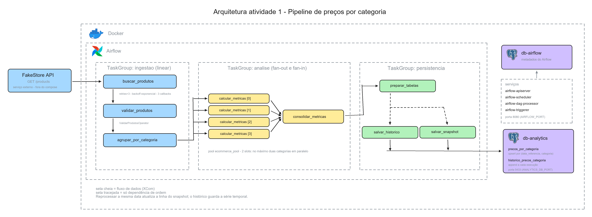

# Atividade 1 da disciplina de Orquestração de Workflows

Atividade 1 realizada por Rafael Santos Souza da disciplina Orquestração de workflows
ministrada pelo prof. Reinaldo Carlos Mendes.

Pipeline no Airflow que aposenta o script agendado no cron: busca os produtos da API de
catálogo (FakeStore), calcula quantidade de produtos e preço médio, mínimo e máximo por
categoria, e grava o resultado em PostgreSQL. Roda todo dia às 06:00 (America/Sao_Paulo).



## Como rodar

Precisa de Docker com uns 4 GB de memória disponíveis.

```bash
git clone https://github.com/Rafasansouza/atividade1-orquestracao-de-workflows.git
cd atividade1-orquestracao-de-workflows
cp .env.example .env
docker compose up -d
```

No Windows, o comando do `.env` é `Copy-Item .env.example .env`. No Linux, acrescente
também o seu UID, para os arquivos em `logs/` não ficarem como root:

```bash
echo "AIRFLOW_UID=$(id -u)" >> .env
```

O `.env` guarda portas, usuário e senha. Ele é opcional: sem o arquivo, o compose usa
exatamente os mesmos valores como padrão.

A primeira subida demora alguns minutos: baixa a imagem do Airflow e roda o `airflow-init`,
que aplica as migrations e cria o usuário admin, o pool `ecommerce_pool` e a connection
`postgres_analitico`.

## Acessar

UI em http://localhost:8080, usuário `airflow`, senha `airflow`.

O DAG `precos_por_categoria_diario` sobe pausado. Para rodar na hora, despause e dispare
pela UI ou por linha de comando:

```bash
docker compose exec airflow-scheduler airflow dags unpause precos_por_categoria_diario
docker compose exec airflow-scheduler airflow dags trigger precos_por_categoria_diario
```

## Conferir o resultado

```bash
docker compose exec db-analytics \
  psql -U ecommerce -d ecommerce -c "SELECT * FROM precos_por_categoria ORDER BY categoria;"
```

```
 data_referencia |    categoria     | qtd_produtos | preco_medio | preco_minimo | preco_maximo
-----------------+------------------+--------------+-------------+--------------+--------------
 2026-11-25      | electronics      |            6 |      332.50 |        64.00 |       999.99
 2026-11-25      | jewelery         |            4 |      221.00 |         9.99 |       695.00
 2026-11-25      | men's clothing   |            4 |       51.06 |        15.99 |       109.95
 2026-11-25      | women's clothing |            6 |       26.29 |         7.95 |        56.99
```

A tabela `historico_precos_categoria`, no mesmo banco, guarda uma linha por execução, para
acompanhar a evolução dos preços.

## Parar

```bash
docker compose down      # para os containers
docker compose down -v   # para e apaga os dados gravados
```

## Onde está cada requisito

| Requisito | Onde |
| --- | --- |
| TaskFlow API, dependências pela chamada das funções | `dags/precos_por_categoria.py` |
| XCom automático via `return` | todas as tasks |
| Linear, fan-out e fan-in | TaskGroups `ingestao` e `analise` |
| Timezone, `start_date`, `catchup=False` | cabeçalho do `@dag` |
| Retry com backoff e `try/except` + `raise` | `buscar_produtos` e `src/shopbrasil/api.py` |
| `on_failure_callback`, `on_retry_callback`, `on_success_callback` | `src/shopbrasil/alertas.py` |
| Dynamic Task Mapping | `calcular_metricas.expand(...)` |
| Pool `ecommerce_pool` com 2 slots | `docker-compose.yaml` (init) e `@task(pool=...)` |
| Dois ou mais TaskGroups | três grupos no DAG |
| `PostgresHook` + Connection | `src/shopbrasil/postgres.py` e `postgres_analitico` |
| Gravação idempotente | `UPSERT_SNAPSHOT` em `src/shopbrasil/postgres.py` |
| Operador customizado (opcional) | `src/shopbrasil/operadores.py` |
| Tabela de histórico (opcional) | `historico_precos_categoria` |
| SLA/alerta (opcional) | `on_failure_callback` no DAG e na task |
